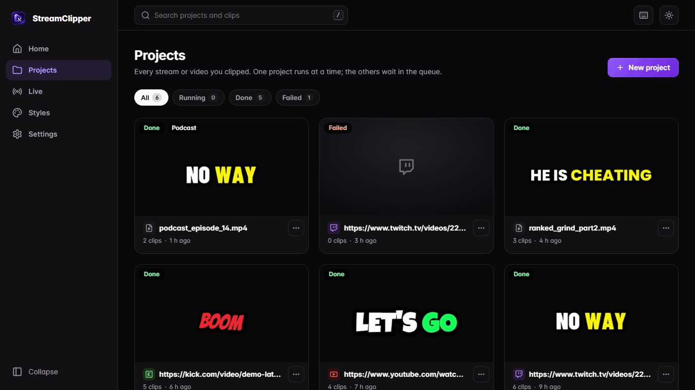

# Clip Studio

> An AI-powered video clipping and editing studio for streamers and creators, turning multi-hour gaming streams into viral, ready-to-post short-form clips and editable CapCut projects.

[Open in Colab](https://colab.research.google.com/github/shubhProcoder/Clip-studio/blob/main/notebooks/StreamClipper_Colab.ipynb) · [Report a Bug](https://github.com/shubhProcoder/Clip-studio/issues)

---

## Preview



## Features

- **Multi-Modal Narrative Highlight Scoring:** Extracts complete storytelling arcs (2-second hook, setup, payoff, reaction) by correlating audio energy, speech recognition, chat velocity, and game visuals.
- **Game-Aware Computer Vision (GTA V & VI):** Real-time HUD detection for WASTED, BUSTED, mission screens, wanted stars, and in-game events to trigger high-scoring clips.
- **Motion-Map Static Range Rejection:** Automatically filters out pauses, inventory menus, death timers, and loading screens via frame-difference motion tracking.
- **Unique-Viewer Chat Velocity Scoring:** Evaluates chat reaction spikes using unique username counts and message acceleration to eliminate spam distortion.
- **Hybrid Facecam Geometry Fusion:** Automatically tracks streamer facecams using MediaPipe and Haar cascades fused with border edge geometry; gracefully falls back to full gameplay when no cam is present.
- **Multi-Track CapCut Desktop Draft Export:** Exports multi-track `.json` projects directly into CapCut Desktop with isolated tracks for video, audio, sound effects, and animated text.
- **15 Animated Caption Presets:** Renders Submagic-style punchy karaoke captions, Comic Burst, Neon Glow, and custom font stylings with zero manual transcription.
- **Creator Workspaces & Publishing Queue:** Organizes multiple channels/creators with isolated settings, custom brand kits, and automated publishing to YouTube Shorts and Instagram Reels.
- **Live Stream Processing Engine:** Connects to live Twitch and YouTube broadcasts, generating short clips within ~35 seconds of an event.

## Tech Stack

| Layer | Technology |
| :--- | :--- |
| **Media & Video Processing** | FFmpeg 6+, OpenCV, MediaPipe, Canvas API |
| **Speech & Audio Intelligence** | Faster-Whisper (OpenAI Whisper via CTranslate2), RNNoise, libass |
| **Highlight & Narrative Engine** | Multimodal heuristic scoring, Local LLM / Ollama fallback pass |
| **Studio Web Dashboard** | Python Async HTTP Engine, Modern Vanilla JS, HTML5, Lucide Icons |
| **Draft Synthesis** | Native CapCut Desktop JSON Project Schema Engine |
| **Deployment / Environment** | Local PC (Windows, macOS, Linux), Google Colab (T4 GPU) |

## Architecture / Project Structure

```text
Clip-studio/
├── src/streamclipper/
│   ├── quality.py        # Motion-map frame analysis & static range rejection
│   ├── games.py          # Game profile registry, event hooks & GTA VI profile
│   ├── chat.py           # Unique chat reaction velocity & spam filtering
│   ├── facecam.py        # Hybrid facecam border geometry & tracking fusion
│   ├── creators.py       # Multi-creator workspaces & isolated brand kits
│   ├── publish/          # Multi-platform publishing queue & scheduler
│   ├── dashboard/        # Studio web server, REST API & reframe editor
│   ├── asr.py            # Faster-Whisper chunked transcription engine
│   ├── layout.py         # 9:16 layout synthesizer & split-screen reframing
│   ├── scoring.py        # Multi-modal highlight scoring & discovery
│   ├── draft/            # Multi-layer CapCut Desktop project exporter
│   └── render.py         # FFmpeg video filtergraph pipeline
├── notebooks/            # Google Colab cloud execution notebook
├── docs/                 # Guides, documentation, and interface media
└── tests/                # Test suites (unit, integration, and HUD evaluations)
```

## Quick Start

### 1. Google Colab (Cloud T4 GPU)
Click **[Open in Colab](https://colab.research.google.com/github/shubhProcoder/Clip-studio/blob/main/notebooks/StreamClipper_Colab.ipynb)**, select a **T4 GPU**, paste your stream URL, and click **Run All**.

### 2. Local Installation
```bash
# Clone the repository
git clone https://github.com/shubhProcoder/Clip-studio.git
cd Clip-studio

# Install with dependencies
python3 -m pip install -e ".[asr,vision]"

# Verify environment
streamclipper doctor
```

### 3. Usage Commands
```bash
# Clip a full VOD stream into 9:16 vertical shorts
streamclipper clip-stream --url "https://www.youtube.com/watch?v=VIDEO_ID" --out clips --render

# Launch the browser-based studio dashboard (http://127.0.0.1:8765)
streamclipper dashboard

# Clip a live Twitch stream in real-time
streamclipper live --url "https://www.twitch.tv/CHANNEL" --out live_clips --render
```

---

## Weekly Development Summary (2026‑11‑17 to 2026‑11‑25)

The following log details the development cadence and milestones achieved during this release cycle:

| Date | Commit Hash | Scope & Description | Key Files Touched |
|---|---|---|---|
| **2026‑11‑25** | `942d619` | `chore(release): polish Clip Studio documentation, Colab notebook, and test fixtures` | `README.md`, `pyproject.toml`, `docs/`, `notebooks/` |
| **2026‑11‑25** | `f2cc707` | `feat(workspaces-publishing): creator workspaces, multi-platform publishing queue, and scheduler` | `creators.py`, `publish/queue.py`, `dashboard/publishing.py` |
| **2026‑11‑25** | `350d67a` | `feat(facecam): hybrid border geometry and face tracking fusion` | `facecam.py`, `layout.py`, `tests/test_facecam.py` |
| **2026‑11‑24** | `6585ac2` | `feat(gaming): game profile registry, GTA VI event context, and unique chat reactions` | `games.py`, `chat.py`, `tests/test_games.py` |
| **2026‑11‑24** | `632c508` | `feat(quality): motion-map static range detection and candidate quality rejection` | `quality.py`, `discovery.py`, `tests/test_quality.py` |
| **2026‑11‑23** | `c5f5edc` | `feat(dashboard): web studio UI, visual reframe editor, and live stream processing engine` | `dashboard/server.py`, `dashboard/editor.py`, `live/` |
| **2026‑11‑22** | `6842b60` | `feat(scoring): highlight discovery, multimodal scoring engine, and LLM narrative analysis` | `scoring.py`, `discovery.py`, `llm.py`, `story.py` |
| **2026‑11‑21** | `cb15dde` | `feat(vision): face detection, dynamic layout reframing, and HUD event tracking` | `vision.py`, `faces.py`, `layout.py`, `hud/` |
| **2026‑11‑20** | `9ae7be7` | `feat(captions): automated caption styling presets, ASS subtitles, and CapCut draft writer` | `captions/`, `draft/writer.py`, `scripts/capcut_studio.py` |
| **2026‑11‑19** | `6abdd14` | `feat(asr): speech recognition engine, region transcription, and audio enhancement` | `asr.py`, `effects.py`, `fillers.py`, `brand.py` |
| **2026‑11‑18** | `6333c31` | `feat(core): initial Clip Studio architecture, CLI, and video pipeline` | `cli.py`, `options.py`, `download.py`, `render.py` |

---

## ⚖️ License & Copyright

- **Copyright (c) 2026 Shubh Mehrotra (New features and modifications)**
- **Portions Copyright (c) original contributors under AGPL-3.0**

This project is licensed under the terms of the [GNU Affero General Public License v3.0](LICENSE).
