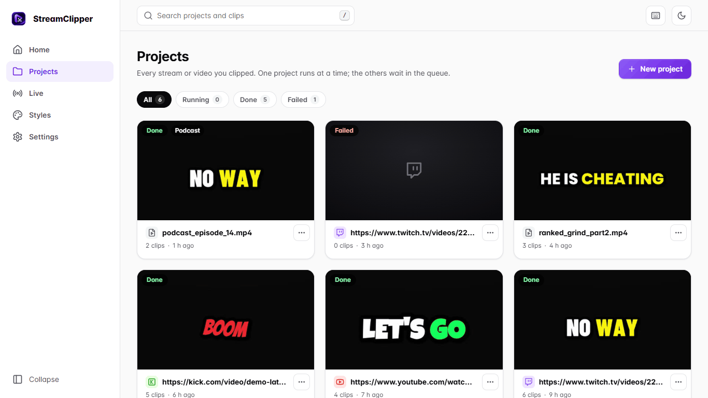
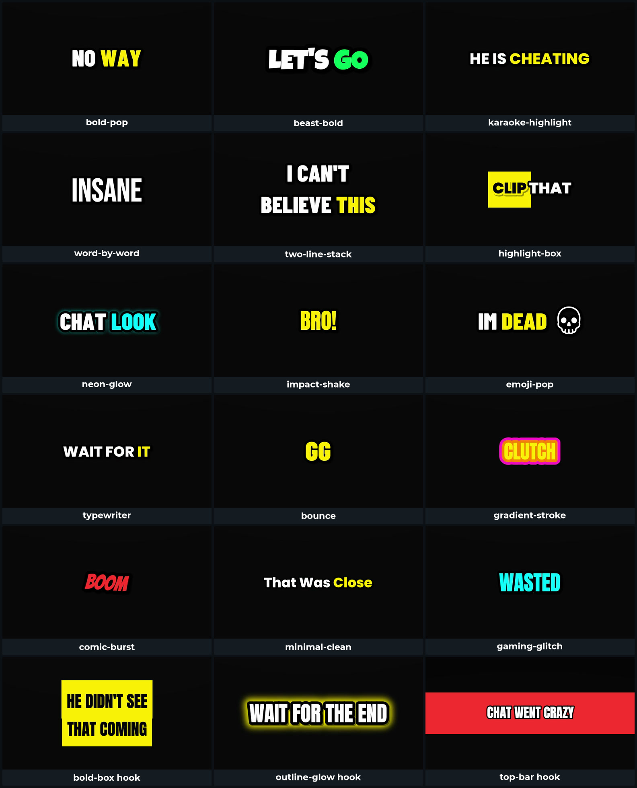

# StreamClipper: full guide

Everything in detail. For the short version, see the [README](../README.md).

## What it does

1. Downloads only the audio of a stream (or reads a local file) and transcribes the whole stream in 10-minute chunks with faster-whisper. Progress is saved after every chunk, so an interrupted run continues where it stopped.
2. Finds every moment worth posting: voice reaction peaks, English stream slang ("no way", "let's go", "clip that", "bro", "W", "GG" ...), laughter, chat replay spikes and, on YouTube, the Most Replayed graph. Each clip is cut as a story (setup, tension, payoff, reaction), never inside a word, with dead air trimmed.
3. Scores each clip 0-100 with a breakdown (hook, story, emotion, pacing, engagement), a one-line reason and a category (funny, rage, clutch, reaction, fail, hot take, reveal, wholesome, chaos). The ranked list goes to `clips.json`, `clips.csv` and a static `index.html`.
4. Renders MP4s (1080x1920, 30 fps, -11 LUFS) with one of 15 caption styles, a hook headline, sound effects and a thumbnail, and checks every file with an export gate.
5. Writes the same clips as CapCut Desktop drafts, with every layer on its own track, so you can fix anything by hand.

## Status

What has been tested, and how. Numbers come from the test runs listed here, not from estimates.

| Mode | Status | Tested on |
|---|---|---|
| VOD (`discover-clips`, `clip-stream`, `render`) | stable | A real 44-min English gameplay stream and a calm 53-min VOD. On a hand-labelled set of 53 candidate windows from these two streams, 87% (busy stream) and 100% (calm stream) of the selected clips are post-worthy, and no big moment is missed. The labels and the tuning used the same two streams, so treat these numbers as optimistic. |
| Live (`live`) | new | One 12-min run on a real English Twitch stream (1080p60): stable ingest, 0 reconnects, Twitch chat read. Clips were ready a median 34 s (max 54 s) after the moment. That run made 4 clips, and 3 passed the export gate; the fourth was too quiet, a loudness bug fixed since then. The same recording replayed through the live path with the final code gave 8 clips, all 8 passing the gate (median 35 s, max 57 s). A fake-live test with planted reactions found 3 of 3. YouTube Live chat and Kick are not tested yet. |
| Podcast (`--preset podcast-9x16`) | beta | One 5-min slice of a two-person interview show with several cameras: 3 clips, all passing the export gate and the caption sync check, faces never cut. One test video only. |
| Colab notebook | tested on Colab | The notebook ran on real Google Colab (free tier, T4 GPU, Python 3.13, ffmpeg 6.1) on 19 Nov 2026, installed from a local build. With Drive: a synthetic test video in a Drive folder gave 2 clips, both passing the export gate, a drafts zip, and a re-run that kept the finished clips. Without Drive: a public 8-min YouTube video (no bot check that time) gave 3 clips, all passing the gate, downloaded as a zip. Live cell: 4 min on a live Twitch stream gave 2 clips with 0 reconnects; one passed the gate, the other was too quiet (-14.4 LUFS) because of a limiter bug that is fixed in 5.3.0 and covered by a test, but not yet re-checked on Colab. On the first run Whisper fell back to the CPU (Colab's image has no CUDA 12 cuBLAS); fixed in 5.3.0. |
| Linux | tested in Docker | python:3.12-slim (ffmpeg 7.1) and ubuntu:22.04 (ffmpeg 4.4, Python 3.10), CPU only: install, doctor, the test suite, clip-stream with renders and the export gate, effects, `--hud generic` and the notebook via nbconvert. Headless Linux without libEGL cannot start MediaPipe; the Haar fallback is used and `doctor` names the fix (`apt-get install -y libegl1 libgles2`). |
| Game HUD (`--hud`) | new | GTA V profile measured on 4 public GTA V videos (2 to calibrate, 2 to test): precision 1.00, recall 0.71 on the test videos. GTA 6 profile is experimental until its HUD is calibrated. See Game HUD detection. |
| Publishing (`publish`) | new | Tested only against a mocked API (no real upload was made). A real upload needs your own credentials. |

## StreamClipper and paid clipping tools

| | StreamClipper | Paid cloud clippers |
|---|---|---|
| Price | free, AGPL-3.0 licence | monthly plans |
| Stream length | no limit (8-10 h streams are chunked and resumable) | limited per plan |
| Clips per stream | every clip that passes the quality bar, ranked (quality over quantity) | depends on the plan |
| Score with breakdown and reason | yes | yes |
| Animated caption styles | 15 styles, 3 hook banner styles | yes, more templates |
| Editable project files | CapCut Desktop drafts | usually their own web editor |
| Layouts | facecam + gameplay split, square frame, full frame, hook-grabber, speaker (podcasts) | yes |
| Live clipping (clips while the stream runs) | yes, `streamclipper live` | some |
| Face tracking / multi-person reframe | MediaPipe face detection with smoothing and active-speaker choice (podcast layout, Auto-reframe) | yes |
| Game events on screen | GTA V HUD (WASTED, BUSTED, mission screens, wanted stars); GTA 6 experimental; a generic profile | some (multimodal tools) |
| Editing effects | punch-in zoom, filler-word removal, speech cleanup, brand kit (logo, handle, font, colours, intro/outro) | yes, more |
| Speed | depends on your GPU or the Colab T4 | faster, on their cloud GPUs |
| Auto-posting and scheduling | YouTube Shorts and Instagram Reels with your own API credentials, a 7-day schedule; TikTok as a publish pack | yes |
| Languages | English first; Hindi (Devanagari) and other Whisper languages | varies |
| Your files stay with you | yes (your PC or your Google Drive) | uploaded to their servers |

For reference, as of 17 Nov 2026: OpusClip's free plan adds a watermark and gives 60 credits a month, and its paid plans start at $15/month ([opus.pro/pricing](https://www.opus.pro/pricing)). ScaleReach's Pro plan costs $18/month (billed monthly) and takes files of up to 3 hours ([scalereach.ai](https://www.scalereach.ai/)). Both are polished products with features StreamClipper doesn't have, such as a web editor, B-roll and cloud speed. StreamClipper is free, has no length limit, clips live streams, and gives you editable CapCut drafts.

## Quickstart: Google Colab (no strong PC needed)

1. Click **Open in Colab** above, then choose **Runtime > Change runtime type > T4 GPU**.
2. Run the cells from top to bottom. Paste a stream link (or the Drive path of a video you uploaded) in cell 5 and pick the options in cell 6.
3. Get the results from `MyDrive/StreamClipper/` on Google Drive: MP4s, thumbnails, `clips.csv`, `index.html` and `capcut_drafts.zip`. To edit in CapCut, copy `capcut_drafts.zip` to the repo folder on your Windows PC, close CapCut and run:

```powershell
streamclipper import-draft --zip capcut_drafts.zip
```

The notebook uses only form fields and inline HTML (no web UI, no tunnels), so it works on the free tier. Cell 8 shows result cards: thumbnail, player, score, and title/description/hashtags with Copy buttons. If YouTube answers "Sign in to confirm you're not a bot" (common on Colab), upload the VOD to Drive and use its path, or set a `cookies.txt` path in cell 5. A cookies file gives access to your account: never share it.

## Quickstart: Windows PC

You need Python 3.10 or newer and ffmpeg (`winget install Gyan.FFmpeg`, then open a new terminal). Open PowerShell in the repo folder and put your stream recording there as `my_stream.mp4`.

### With an NVIDIA GPU

```powershell
python -m pip install -e ".[asr,gpu,vision,dev]"
streamclipper doctor
streamclipper discover-clips --video my_stream.mp4 --out clips.json
streamclipper render --clips clips.json --video my_stream.mp4 --max-clips 3 --out renders
streamclipper audit --mp4 renders\clip_01.mp4
streamclipper clip-stream --input my_stream.mp4 --out work --prefix MyClip --max-clips 3 --render
streamclipper audit --draft MyClip_01
```

1. `pip install` installs the `streamclipper` command, faster-whisper, the CUDA libraries, OpenCV for face detection (`vision`) and the test tools (`dev`).
2. `doctor` checks Python, ffmpeg, yt-dlp, Whisper, CUDA, CapCut, fonts and effects, with a fix for each missing item.
3. `discover-clips` transcribes and scores the stream and writes `clips.json`, `clips.csv`, `index.html` and preview images. Nothing is rendered yet. Open `index.html` to see the ranked list.
4. `render --clips` makes MP4s and thumbnails of the 3 best clips in `renders\` (no CapCut needed). It leaves `clips.json` as it is and writes the MP4 links to `clips_rendered.json` (+ `clips_rendered.csv`, `clips_rendered.html`) next to it.
5. `audit --mp4` runs the export gate on an MP4 again.
6. `clip-stream` does discovery and builds one CapCut draft per clip (`MyClip_01`, `MyClip_02`, `MyClip_03`), and with `--render` also the MP4s in `work\`. Close CapCut Desktop first. All clips above the score go to `work\clips.json`; `--max-clips 0` makes drafts for all of them.
7. `audit --draft` checks a draft: files, materials, track overlaps, caption ranges and registration in CapCut's draft list.

### Without a GPU (CPU only)

```powershell
python -m pip install -e ".[asr,vision]"
streamclipper discover-clips --video my_stream.mp4 --out clips.json --device cpu
streamclipper render --clips clips.json --video my_stream.mp4 --max-clips 1 --caption-style karaoke-highlight --out renders
```

On a CPU the automatic Whisper model is `small` for streams up to 30 minutes and `base` for longer ones (see Measured speeds).

`python scripts\capcut_studio.py <command>` still works and runs the same CLI, with or without `pip install`.

### More examples

```powershell
streamclipper styles
streamclipper styles --preview --out style_previews
streamclipper discover-clips --url https://youtu.be/VX8hvc4WMN4 --out yt_clips.json
streamclipper render --clips clips.json --video my_stream.mp4 --max-clips 1 --preset square-frame-9x16 --caption-style comic-burst --hook-style top-bar --out renders
streamclipper render --clips clips.json --video my_stream.mp4 --max-clips 1 --ratio 1:1 --prefix square --out renders
streamclipper render --clips clips.json --video my_stream.mp4 --max-clips 1 --preset hook-grabber-9x16 --filler-video filler.mp4 --prefix grabber --out renders
streamclipper download-vod --url https://youtu.be/VX8hvc4WMN4 --start 60 --end 70 --out slice.mp4
streamclipper build-clipper --spec clip_spec.json --render
```

- `styles` lists the caption styles, hook styles and caption fonts. `styles --preview` renders a 4 s sample MP4 and PNG of each one into `style_previews\` plus `styles_gallery.jpg` (about 2 minutes).
- `discover-clips --url` downloads the audio only; on YouTube it also uses the Most Replayed graph and the live chat replay when the video has one.
- `--preset hook-grabber-9x16` puts the clip on top and a muted `filler.mp4` (footage you have the rights to) below it.
- `download-vod` downloads 60-70 s of a video as H.264/AAC MP4 (at most 1080p).
- `build-clipper` builds one clip from a hand-written spec (see Clip spec).

Names are never overwritten: if `MyClip_01` (draft or MP4) exists, the new one becomes `MyClip_01_2`. Pass `--overwrite` to replace it.

## Live clipping quickstart

`streamclipper live` clips a stream while it is still running, so clips are ready minutes after a moment instead of after the stream ends. It works with Twitch, YouTube Live and Kick (Kick is best-effort), an `.m3u8` link or a local file.

```powershell
python -m pip install -e ".[asr,gpu,vision,dev]"
streamclipper live --url https://www.twitch.tv/<channel> --out live_clips --render
```

- The stream is recorded into 10-second pieces in `live_clips\buffer\` (the last 15 minutes are kept; set `--buffer-min`). The tool deletes only the pieces it recorded itself.
- Every new piece is transcribed with Whisper, and the same scoring and quality bar as the VOD mode runs on the last 10 minutes. When a moment passes the bar, the tool waits until the reaction ends (at most 20 s), then cuts the clip from the buffer and renders it in the background.
- The console prints one line per clip, for example:
  `CLIP 01 | 01:05 into stream | score 56 | '75 Gold Right Now?' | live_clips/LIVE_01.mp4 | ready 57 s after the moment | gate PASS`
- `clips.json`, `clips.csv` and `index.html` in `live_clips\` are updated after every clip.
- Press **Ctrl+C** to stop. The clip being rendered and the clips that are already queued are finished first (renders run in their own process group, so the key press reaches only streamclipper). `--stop-after 60` stops after 60 minutes; by default it runs until the stream ends.
- Disk use stays bounded: each moment's window file in `live_clips\windows\` is deleted once its clip is made (a failed clip keeps its window for a re-run). The panel files in `panels\` stay, because CapCut drafts and the re-render command use them. `--max-disk-gb 20` (default) prints a warning when the output folder grows past 20 GB; nothing else is deleted.
- Limits: `--max-clips-per-hour 12` (default) caps the output, `--min-score` is the same quality bar as in the VOD mode, and `--prefix` sets the file names. `--chat off` skips the Twitch/YouTube chat signal. The layout, caption and draft flags are the same as in `clip-stream`.
- On Colab, cell **10. Live clipping (optional)** does the same: paste the stream link, set how many minutes to run, and the clips go to `MyDrive/StreamClipper/live/`. The rolling recording stays on the Colab disk (`/content/streamclipper_live/`); only finished clips, thumbnails, `clips.json`, `clips.csv` and `index.html` are copied to Drive, after every clip, so the recording never fills your Drive or its trash.

### Colab without Google Drive

Untick `use_google_drive` in cell 4. Nothing is mounted; the outputs stay in `/content/StreamClipper` and cell 9 downloads them as `streamclipper_outputs.zip`. Without Drive the progress is not saved: if Colab disconnects, the run starts over. With Drive, access stays inside your own Google account. StreamClipper has no server.

### Drive share links (Colab, opt-in)

Tick `share_on_drive` in cell 6 (default off). After the run, every finished MP4, `index.html` and `clips.csv` gets an "anyone with the link can view" link in your own Drive (files outside Drive are uploaded to `MyDrive/StreamClipper_shared/`). The links go into `clips.json`, `clips.csv` (column `drive_link`), `index.html` and the result cards. Anyone with a link can see the clip; remove sharing in Google Drive to stop it. On a PC, use the dashboard's LAN share links instead.

## Dashboard

```powershell
streamclipper dashboard
```

The dashboard is a small web app on your own PC (`http://127.0.0.1:8765`). It opens in your browser; close it with Ctrl+C in the terminal. Flags: `--port 8765`, `--workspace DIR` (default `~/StreamClipper`), `--no-browser`, `--lan`, `--draft-root DIR` (CapCut draft folder for Open in CapCut).



The left sidebar has five pages (on a phone it becomes a bar at the bottom). `/` jumps to the search box, `?` lists the keyboard shortcuts.

- **Home:** paste a stream link or drop a video, then **Get clips**. One click works with your saved defaults; **Advanced** has the mode (VOD, podcast, live; Auto picks live for `twitch.tv/<channel>` and `kick.com/<channel>`), preset, ratio, minimum score, number of clips, AI for titles (only what is available), MP4s and CapCut drafts. The first time, a **Set-up check** card runs the doctor in the background and shows ffmpeg, GPU (optional, CPU works, just slower) and CapCut (optional, only for drafts) with fix links. Your last four projects are listed below.
- **Projects:** one card per job with thumbnail, source, status, progress ring and clip count; filter by All / Running / Done / Failed or search. Cancel and Resume are in the card menu. One job runs at a time; the others wait in the queue. Every job is the normal `streamclipper` command in its own process, so a crash never stops the dashboard. Resume continues from the saved progress (`state.json`). After a restart, past jobs are listed again; a job that was running shows Resume.
- **Project page (clips):** vertical cards that play on hover, a score badge (hover for the breakdown), category, title and length. Quick actions: Edit, Download, Copy caption, Share (`--lan` only) and Open in CapCut; the **...** menu has Posted, Rejected, Re-render with another style (the new MP4 gets a `_2` name), the export audit table and Delete. Sort by score or time; filter by category or posted status. Delete moves the clip's own files to `<workspace>/trash/` (nothing is deleted for good). Open in CapCut imports the clip's draft into CapCut's draft list; CapCut must be closed ("Close CapCut first"), and the dashboard never closes it.
- **Edit:** the reframe editor, see below.
- **Live:** start and stop a live session; clips show up while it runs, with the time from the moment to the finished clip.
- **Styles:** every caption and hook style as a preview tile; **Set as default** saves it for new jobs.
- **Settings:** defaults, workspace folder, the CapCut draft folder, whether a Gemini key is set (the key itself is never shown), share links with Revoke, and the system check (doctor table).
- **Themes:** light and dark; the default follows Windows, the sun/moon button switches it.

### Reframe editor

Open a clip with **Edit**. The source video (16:9) is on the left with the crop window(s), the output (9:16 or 1:1) on the right. The output is drawn live from the source in the browser with the same maths as the render, so what you see is what you get (only the caption look is approximate).

- **Crop windows.** Drag a window to move it, drag its corner to resize. Its shape is locked to the panel it fills, it stays inside the frame and is at least 64 x 64 px. The split layout has two windows: Facecam (top panel) and Gameplay (bottom panel).
- **Segments.** **Split** (or `S`) cuts the clip at the playhead; each segment has its own layout (full, split, square frame, caption punch, speaker) and its own windows. The segment under the playhead is the active one; click a block on the timeline to jump to it. **Merge** (in the toolbar's **More** menu, with Delete keyframe and Reset crop) joins a segment with the one before it. A segment is at least 0.5 s long; a clip has at most 20 segments.
- **Keyframes.** **Keyframe** adds one at the playhead; with keyframes, dragging the window at the playhead moves the crop at that time (a new keyframe is added if there is none). Drag a diamond on the timeline to change its time, `Delete` removes the one at the playhead. Easing is smooth or linear; at most 12 keyframes per segment. Keyframes **pan** a window; they do not zoom. ffmpeg's `crop` filter evaluates the position for every frame but the size only once, and scaling with a changing size needs ffmpeg 5 (Ubuntu 22.04 still has 4.4). To change the size, split and resize the window in the new segment; a resize applies to all keyframes of the segment.
- **Joins.** The marker between two segments is a cut (`|`, default) or smooth (`~`): the last 0.5 s of the left segment eases its window to the right segment's first position. Smooth needs the same layout and the same window size on both sides; otherwise the marker is disabled.
- **Auto-reframe** finds the face every 0.5 s (MediaPipe, `pip install "streamclipper[vision]"`; see Face tracking) and proposes keyframes about once a second so the window follows it (speed-limited and smoothed; in split only the facecam window moves; a full crop puts the face in the upper third where the source allows). When the face is a facecam overlay in a corner, those segments are set to Split instead, so the face is not stuck low in a full-height crop. It runs in the background, one run per clip. **Reset crop to auto-detected** (More menu) puts the active segment's window back to the detected crop without keyframes.
- **Timeline:** thumbnails, waveform, the In/Out handles (they snap to word edges; untick Snap to words to cut freely, up to 10 s before and after the clip), segment blocks, keyframe diamonds and a chip per caption word (click it to edit the word).
- **Captions.** Drag the captions on the output up or down; they snap to a safe zone (top, upper middle, lower, and the seam in split). A chip warns when the caption would cover a face (found by Auto-reframe, or the facecam panel); the export gate checks it again. **Auto position** gives the layout's own place back. Caption and hook styles are picked from the preview tiles and show at once. Fix misspelled words in place; timings stay.
- **Undo / Redo:** `Ctrl+Z` and `Ctrl+Shift+Z` (or `Ctrl+Y`), up to 100 steps. **Discard changes** drops the saved edit and goes back to the last rendered version.
- **Render** makes a new MP4 through the normal render path and export gate (named `_2`, `_3`, ...). **Versions** lists every render and draft; **Compare** plays the original and the chosen version side by side (play, pause and seek together) with both audit tables. **Save as CapCut draft** writes a draft (CapCut must be closed). Every version is kept in `<workspace>/jobs/<id>/edits/<clip>/`.

**How a segmented edit is rendered.** One ffmpeg graph per edit: the source is read once at 30 fps, each segment is cut on exact frame numbers (`trim`), each window is cropped with time expressions for its pan (`crop=w:h:x='...':y='...'`), scaled, stacked for split, and the segments are joined with `concat` into one full-canvas panel with the source audio as one continuous stream. The normal MP4 render then adds captions, loudness and the export gate. This keeps the timeline length exact and the audio free of gaps or loudness steps at the joins, and it works on ffmpeg 4.4 to 8. It was chosen over one MP4 per segment plus the concat demuxer (AAC gaps and loudness steps at each join) and over `sendcmd` (behaviour differs between ffmpeg versions). Captions keep the source time of each word, so they stay in sync across segments; each word belongs to the segment it starts in. An edit with one segment and no keyframes uses the old one-layout render.

**CapCut drafts of a segmented edit:** the composite panel is the video, cut into one video segment per editor segment. Crops and pans are baked into the picture; the draft has no CapCut keyframes. The podcast speaker layout's side-by-side stacking stays a one-segment feature.

| Key | Action |
| --- | --- |
| `/` | Search projects and clips |
| `?` | Show the shortcuts |
| `Space` | Play or pause |
| `J` / `K` / `L` | Back 5 s / pause / forward 5 s (`L` while playing = 2x) |
| `S` | Split at the playhead |
| `[` / `]` | Set the start / end at the playhead |
| `Delete` | Delete the keyframe at the playhead |
| `Ctrl+Z` / `Ctrl+Shift+Z` | Undo / redo |

Workspace layout: `jobs.json`, `settings.json`, `shares.json`, `uploads/`, `trash/`, and per job `jobs/<id>/job.json`, `log.txt`, `out/` (clips.json, MP4s, thumbnails, `.gate.json` audit) and `capcut_drafts/`.

**Security.** By default the dashboard listens only on 127.0.0.1, so only this PC can open it. `--lan` makes it reachable on your network: it prints a link with a random access token and a warning; requests without the token are refused. Use it only on a trusted Wi-Fi. Every change needs a per-start security token and a same-origin request, files are served only from the job folders, and jobs run without a shell. On the network, only uploaded videos can be used as a source.

**Share links (`--lan` only).** The Share button of a clip or a job makes a view-only link (play and download) that works for people on the same Wi-Fi/network while the dashboard runs. Each link has its own random token, expires after 1, 7 or 30 days and can be revoked in Settings. Only a hash of the token is stored.

## Podcasts and interviews (beta)

```powershell
streamclipper clip-stream --input my_podcast.mp4 --out podcast_work --preset podcast-9x16 --render
```

- `--preset podcast-9x16` sets `--content talk` and the `speaker` layout. Clips are picked from what is said: strong lines ("here's the thing", "nobody talks about", "are you serious", amounts like $500), laughter and, with `--llm`, self-contained stories and punchlines. A calm conversation does not need loud moments to give clips.
- The `speaker` layout works shot by shot. When one face is on screen, the 9:16 crop follows it slowly (at most 4% of the frame width per second, so it never jitters). Two people side by side are stacked, left person on top. B-roll without a face is shown whole over a blurred fill. Black frames between shots are cut out when nobody is speaking.
- Face detection needs the `vision` extra (`pip install -e ".[vision]"`; the Colab notebook installs it). With two or more people, the crop goes to the one who is talking (see Face tracking). Without it, every shot is shown whole.
- `--content talk` also works with `discover-clips` and `live`, for example: `streamclipper discover-clips --video my_podcast.mp4 --out podcast_clips.json --content talk`.

## Quality over quantity

The goal is clips you would post, not a high clip count. A clip is kept only when it has a setup, a payoff that stands out and a reaction after it, with real words in it. A calm 1-hour stream may give only 4 clips, and that is the intended result.

- `--max-clips` is a cap, not a target: 0 keeps every clip that passes the bar.
- `--min-score` (default 50) is the score part of the bar. Lower it (for example `--min-score 40`) to see more candidates, or use `--min-score 0` to list every candidate without the bar. Check `index.html` before posting.
- Clips are at most 60 s (`--max-dur 60`), and rendered clips stay at or below 59.5 s, so they fit YouTube Shorts, Reels and TikTok.

## Does it need AI?

Not a paid one, and no API key. Clips are found from the audio (voice peaks, laughter, silence), the words (Whisper speech recognition) and rules (trigger phrases, the quality bar). Whisper is an open model that runs on your GPU, your CPU or the Colab GPU. Nothing is sent to an online service.

An LLM is optional: `--llm ollama` runs a local model (free), and `--llm gemini` uses your own free key in env `GEMINI_API_KEY`. It adds story segments, hooks, titles and hashtags. Without it, every clip still gets a title, a description and hashtags written by simple rules.

## How clips are found and scored

- **Candidates.** Every voice peak at least 6 dB above the stream's rolling 60 s median, every chat replay spike (messages per second against a rolling 120 s median, plus words like KEKW, LUL, W, "clip it", 😂, 💀) and, with `--llm`, every payoff the LLM proposes.
- **Story window.** The start is the sentence end or silence 10-25 s before the peak with the longest pause before it. The end is the first pause 2-5 s after the peak, so the reaction plays out. Pauses over `--min-pause` (0.55 s) are trimmed, except around the peak.
- **Score.** Five 0-100 components (six when a game event is on screen), weighted and renormalised over the ones that are available:

| Component | Weight | From |
|---|---|---|
| hook | 20 | a trigger word or strong phrase in the first 2 s (needs a transcript) |
| story | 25 | payoff louder than setup, reaction coverage, LLM story score |
| emotion | 25 | reaction intensity, shock, laughter and screams |
| pacing | 10 | speech rate and dead air removed |
| engagement | 20 | chat spike and YouTube Most Replayed (only when available) |
| hud | 15 | a game event on screen, such as WASTED (only for windows with an event; see Game HUD detection) |

- **Selection.** Only clips that pass a quality bar are kept: a score of at least `--min-score` (default 50; 40 for a scream or a line like "finally" or "I did it"), a setup before the payoff, a payoff that stands out from the usual voice level (an LLM pick the model scored 70+ with real speech, 1.2 words/s, is exempt from that floor), a reaction after it, and real words (a chant or a transcription loop fails). Clips are picked best first without overlaps; `--max-clips` is a cap, not a target (0 = all that pass). A calm stream can give only a few clips, which is the point. `--min-score 0` lists every candidate without the bar. On the two streams the bar was built on, 87-100% of the selected clips are post-worthy; on streams it was not built on the number is much lower (see Selection quality).
- **Titles without an LLM.** With `--llm none` every clip still gets a title (from the hook, in Title Case, unique per stream), a one-sentence description and hashtags (category, keywords, `#shorts #gaming`; `#GTA6` only when the stream mentions GTA).
- **Categories.** A rule table maps words and sounds to a category; with `--llm` the LLM's category is used.
- **LLM (optional).** `--llm ollama` (local, free) or `--llm gemini` (your own free key in env `GEMINI_API_KEY`) reads the transcript in 15-minute windows (about 4 calls an hour) and proposes story segments, a hook, a title, a description and hashtags. Each transcript line is prefixed with `(LOUD)` when the streamer's voice peaked on it and `(CHAT)` when the chat got busy on it, so the model can weigh the live reaction next to the story; quiet lines with no marker are still valid picks. A per-minute rate limit (HTTP 429) is retried after 20 s and then 40 s, a daily quota moves straight to the next model in the fallback list, and the tokens used are printed at the end of the pass. Everything works with `--llm none` (the default); titles, descriptions and hashtags then come from the rules above.

## Selection quality

Checked on 8 public streams that were not used to build the rules: 6 GTA RP VODs from 6 streamers, 1 Just Chatting stream and 1 podcast (the first 90 min of VODs longer than 2 h). The split into 5 tuning streams and 3 held-out streams was drawn at random before any result was seen, and the 492 candidate windows were labelled blind by the maintainer's tooling (29 post-worthy, 2 big moments). The anonymised labels are in `tests/fixtures/eval/v53_*.json`; run `python tools/eval_selection.py --split tune|holdout`.

| Streams | Precision (picked clips that are post-worthy) | Big-moment recall | Post-worthy recall |
|---|---|---|---|
| Tuning (5 new + the 2 earlier streams) | 0.16 (19 of 118) | 5 of 6 | 0.58 |
| Held out (3 streams) | 0.08 (5 of 62) | 0 of 1 | 0.45 |

Tuning the thresholds on the 5 streams raised their precision to 0.20, but the held-out precision fell to 0.078, so 5.3.0 keeps the 5.2 values. In plain words: on long RP, Just Chatting and podcast VODs about 1 pick in 6 to 12 is worth posting, because most voice peaks there are talk without a payoff. Use `--llm ollama` and review `index.html` before posting. The face signal is recorded per clip but not scored, because it did not help the held-out streams.

## Gaming intelligence upgrade

- **Static-screen filtering.** VOD discovery can run `--static-analysis on` (the default). It uses an FFmpeg luma-difference map with `--static-bucket 2`, `--static-min 6` and `--static-threshold 0.4`. Dominated static candidates are rejected; partially affected candidates are penalised. A payoff in a genuine gameplay pause is protected from blanket rejection. The threshold is a starting value and should be calibrated for representative ads, BRB screens, menus and gameplay.
- **Game profiles.** `--game "GTA VI"` forces the selected game and overrides title detection. GTA VI is also detected from GTA 6/GTA VI/GTA6/Leonida text and gets GTA-specific event context, hooks and tags. Unknown games fall back to the Generic Gaming profile. The registry is extensible and does not claim tags are trending.
- **Unique chat reactions.** Replay/live chat tracks total messages, distinct normalized usernames, unique-user windows, chat acceleration and repetition/spam indicators. Anonymous chat falls back to message-rate analysis. Spam/repetition reduces a hype signal rather than automatically marking it excitement.
- **Hybrid facecam.** Face evidence from the existing MediaPipe/Haar detector is fused with persistent rectangular border geometry. Manual `--cam-crop` overrides remain authoritative. Low-confidence and no-camera layouts fall back to full gameplay; the confidence and method are stored in layout diagnostics.
- **Creator workspaces.** Jobs can belong to a creator or the default Personal workspace. Dashboard API routes expose `/api/creators`, and existing jobs migrate to `default` safely.
- **Publishing queue.** The dashboard keeps a persistent queue in the workspace and account metadata in private config. Jobs can target YouTube, Instagram and TikTok export packs. Duplicate uploads are prevented, posts respect interval/daily-cap settings, temporary failures retry with bounded exponential backoff, and every outcome remains in the queue history.

## Game HUD detection

`--hud auto|off|gta5|gta6|generic` (default `auto`) on `discover-clips` and `clip-stream` looks at the game screen for events. `--hud-profile FILE` uses your own profile (for example one made by `calibrate-hud`).

- **Profiles** are JSON files in `src/streamclipper/data/hud/`. `gta5`: WASTED, BUSTED, MISSION PASSED, MISSION FAILED and a wanted level of 3 or more stars. `gta6`: experimental, a copy of the GTA V profile until the GTA 6 HUD is calibrated. `generic`: big text, white flashes and kill-feed bursts (not measured).
- **auto** picks `gta6` or `gta5` from the title or file name (`gta 6`, `gta vi`, `grand theft auto vi` ...), else `gta5` when at least 2 keyframes show a GTA V word, else `generic`.
- **How it reads the screen.** One pass over the keyframes at 640 px (about one frame per 2 s), then a 3 fps pass around each candidate and each hit. Text is read with a small PaddleOCR English model run by onnxruntime (about 7.6 MB, downloaded once and checked by SHA-256); colour cues (red or grey screen, gold text) and star shapes need no model. For a link, only a 360p video-only copy is downloaded, and HUD is skipped with a notice when that copy would be larger than 1.5 GB (a forced profile such as `--hud gta5` still runs). Live mode has no HUD.
- **Scoring.** A window with an event gets the `hud` component (weight 15) and a reason such as "WASTED on screen". A strong event (WASTED, BUSTED, mission screens) lets a clip pass the bar like a milestone line, and an event without a voice peak nearby adds a candidate 2 s before it. Windows without events score exactly as before.
- **Measured** with `python tools/eval_hud.py` (labels as timestamps in `tests/fixtures/hud/`; 2 s window). Test videos (2 public GTA V videos not used for calibration):

| Event | Precision | Recall |
|---|---|---|
| mission_failed | 1.00 | 0.74 (23 of 31) |
| mission_passed | 1.00 | 1.00 (1 of 1) |
| wanted_3plus | 1.00 | 0.33 (1 of 3) |
| all test events | 1.00 | 0.71 (25 of 35) |
| busted | no example in the test videos | |

On the 2 calibration videos WASTED was found 1 of 1 and the wanted level 2 of 2. A white-flash cue was dropped from the GTA profiles because it fired on fade-ins (test precision 0.00). Misses are fail screens shorter than 2 s and wanted-level changes right after an edit cut. RP servers often hide or replace the standard HUD: on the 6 GTA RP VODs of the selection test, the GTA V profile found 0 to 1 events per stream.
- **Timing:** the keyframe pass takes about 2-4 s per stream minute at 360p, so about 7-12 minutes for a 3 h stream.
- **GTA 6 (after release on 19 Nov 2026).** `streamclipper calibrate-hud --video my_gta6.mp4 --profile gta6 --times 12:34,15:10` reads the screen at those times (or every `--every 30` s), finds where text and colours appear, and writes a profile plus `calibrate_sheet.jpg`. Check a profile with `--check my_profile.json`, then use it with `--hud-profile my_profile.json`.

## Face tracking

The `vision` extra uses MediaPipe's BlazeFace full-range face detector (bundled, Apache-2.0) on 960 px frames, on the whole frame plus a 3x2 grid of tiles so small facecams are found. OpenCV Haar is the fallback when MediaPipe cannot be installed (`pip install "streamclipper[vision-haar]"`). `doctor` shows which detector is active and warns when two OpenCV packages overwrite each other.

- **Smoothing:** the crop follows a smoothed face centre and does not move while the face stays in the middle 30% of the crop; size changes under 15% are ignored.
- **Active speaker:** with 2 or more faces, the crop goes to the face whose mouth moves while someone speaks. It switches only after the new speaker has led for 1 s, and never during silence.
- **Measured** on 3 public videos (60-72 labelled frames each): face found on the frame, Haar -> MediaPipe: corner facecam 0% -> 78%, full-screen cam 58% -> 98%, podcast 75% -> 100%. Crop jitter (px per frame at 1080 wide): full cam 1.32 -> 0.20, podcast 2.56 -> 1.28.

## Caption coverage check

The export gate has a `caption_coverage` row: the share of spoken words that are on screen while they are said, and the longest stretch of speech with no caption. It fails below 97% or above 0.6 s. Words in the tease (the opening flash shows only the hook) do not count. Fixed in 5.3.0 after checking real clips: very short words were dropped or joined badly, and shouted words were missing because Whisper's voice filter skipped them (each clip window now gets one extra pass without that filter). On 14 earlier clips, 10 failed the check before the fixes and none after.

## Effects: punch-in zoom, filler removal, speech enhancement, brand kit

All effects are off by default. They work on `clip-stream`, `render`, `build`/`build-clipper`, the dashboard (Home > Advanced > Editing effects, the editor's Effects card) and the Colab notebook (cell 6).

| Flag | What it does | MP4 | CapCut draft |
|---|---|---|---|
| `--zoom light\|medium\|strong` | a smooth 1.08x / 1.12x / 1.2x punch-in on the payoff and on hype words (at most 6, at least 3 s apart); faces always stay inside the frame, the zoom is lowered or skipped otherwise | yes | scale and position keyframes |
| `--remove-fillers` | cuts "um", "uh", "erm", "hmm", "like," and "you know" used as fillers, never inside a word, never in the payoff, the first 2 s or before a dramatic pause; at most 8 per clip (needs one extra Whisper pass per clip) | yes | yes (same cuts) |
| `--enhance-speech light\|strong` | noise reduction with ffmpeg `arnndn` and a bundled RNNoise model, mixed 60% / 90% wet so game sound stays; it also lowers some room echo | yes | no |
| `--brand-kit FILE` | logo/watermark, `@handle`, your own TTF/OTF caption font, highlight and hook-box colours, an intro/outro card of up to 1.5 s | yes | handle, font and colours; the logo and the cards are MP4 only |

Brand kit JSON (example in `docs/examples/brand_kit.json`; paths are relative to the JSON file):

```json
{"logo": {"image": "brand_logo.png", "position": "auto", "width_pct": 12, "opacity": 0.85},
 "handle": "@myname", "font": "MyFont.ttf",
 "colours": {"highlight": "#FFD400", "hook_box": "#FFD400"},
 "intro": {"text": "WAIT FOR IT", "seconds": 1.0}, "outro": {"image": "outro.png", "seconds": 1.5}}
```

The logo goes in a corner that does not cover captions, faces or the platform buttons (right edge and bottom of a 9:16 frame); if no corner is free it is made smaller, then left out with a notice. An intro card delays the hook, so keep it short or leave it out. The highlight colour is the nearest of the caption colours; the hook box uses the exact hex. Every effect passes the export gate (loudness, true peak, duration with the cards, captions); punch-in zoom and the enhancement filters also run on ffmpeg 4.4.

## Publishing

`streamclipper publish` uploads with your own API credentials. Nothing is posted without them, and tokens stay in your config folder (`%APPDATA%\streamclipper` on Windows, `~/.config/streamclipper` on Linux; env `STREAMCLIPPER_CONFIG_DIR`). Tokens are never printed or logged, and nothing is copied into the workspace. In the dashboard (this PC only, not in `--lan` mode): Settings > Publishing to connect, **Publish** in a clip's menu, **Schedule week** on a project page. On Colab, download the MP4s and publish from your PC. `--dry-run` prints the request and sends nothing.

**YouTube Shorts.**
1. In the Google Cloud console, create a project and enable **YouTube Data API v3**.
2. Set up the OAuth consent screen (External, Testing) and add yourself as a test user.
3. Credentials > Create OAuth client ID > **Desktop app**; download `client_secret_*.json`.
4. `streamclipper publish youtube --clips work\clips.json --rank 1 --youtube-credentials client_secret.json` (once; it opens your browser to sign in), or Settings > Publishing > Connect YouTube.

Uploads are private by default (`--privacy unlisted` on request); `--publish-at 2026-11-21T18:00` schedules one, and YouTube keeps it private until that time. `#Shorts` is added to the description. A consent screen in Testing gives sign-ins that expire after 7 days: connect again, or publish the app. YouTube used to keep every upload from an unverified API project private until an audit; the [revision history](https://developers.google.com/youtube/data/revision_history) entry of 2 Nov 2026 ends that rule. Quota: `videos.insert` has its own bucket of 100 calls a day by default ([quota costs](https://developers.google.com/youtube/v3/determine_quota_cost)); quotas reset at midnight Pacific Time. StreamClipper leaves the paid-promotion field unset, so declare it in YouTube Studio if it applies.

**Instagram Reels.** Needs a professional (Business or Creator) account linked to a Facebook Page, a Meta app with Facebook Login for Business and a long-lived token with `instagram_basic` and `instagram_content_publish`. Put them in a JSON file `{"ig_user_id": "1784...", "access_token": "..."}` and run `streamclipper publish instagram --clips work\clips.json --rank 1 --instagram-credentials ig.json`. Instagram allows 100 API posts per 24 h and has no scheduled posts through the API.

**TikTok.** TikTok's Content Posting API needs an app review, so `streamclipper publish pack --clips work\clips.json` makes `publish_pack/<clip>/` with the MP4, `caption.txt`, `hashtags.txt` and `best_time.txt` for a manual upload.

**Schedule week.** `streamclipper publish schedule --clips work\clips.json --platform youtube --start tomorrow --per-day 1` spreads the best clips over 7 days at 18:00-21:00 on weekdays and 11:00-13:00 at weekends (a common heuristic, not measured on your audience) and writes `publish_schedule.json`. YouTube publishes the scheduled videos itself; your PC only needs to run during the uploads.

## Reference

### Commands

| Command | What it does |
|---|---|
| `doctor` | Checks Python, ffmpeg (libass, harfbuzz, filters), yt-dlp, numpy, faster-whisper, CUDA, CapCut, draft folder, fonts, effects and SFX. |
| `discover-clips` | Finds and scores clips in a file or URL; writes `clips.json`, `clips.csv`, `index.html`. |
| `live` | Clips a stream while it is live (Twitch, YouTube Live, Kick, `.m3u8`, or a file); see Live clipping quickstart. |
| `clip-stream` | Discovery plus one CapCut draft per clip; `--render` adds MP4s and thumbnails. |
| `render` | MP4s only, from `clips.json` (`--clips`), a clip plan (`<name>.clip.json`) or a clip spec (`--spec`). |
| `build` / `build-clipper` | One draft from a clip spec or a low-level timeline spec; `--render` adds the MP4. |
| `import-draft` | Imports a zip of drafts (for example `capcut_drafts.zip` from Colab) into CapCut Desktop and relinks the media. |
| `styles` | Lists caption styles, hook styles and caption fonts; `--preview` renders a sample of each. |
| `download-vod` | Downloads a time range of a video as H.264/AAC MP4. |
| `audit` | `--draft NAME` checks a draft; `--mp4 FILE` runs the export gate. |
| `calibrate-hud` | Reads a game video at chosen times and writes a HUD profile plus a contact sheet; `--check FILE` tests a profile (see Game HUD detection). |
| `publish youtube\|instagram\|pack\|schedule` | Uploads a clip with your own credentials, makes a TikTok publish pack or schedules a week; `--dry-run` sends nothing (see Publishing). |
| `analyze` | Older analysis command: speech islands, webcam box, optional Whisper words and exposure stats. |

Every command has `--help` with the full list of flags.

### Main flags

| Flag | Commands | Meaning [default] |
|---|---|---|
| `--video FILE` / `--input FILE` | discover-clips, render / clip-stream | local stream file |
| `--url URL` | discover-clips, clip-stream | stream or VOD link (audio-only download) |
| `--out PATH` | discover-clips, clip-stream, render, build, download-vod, analyze | output file or folder |
| `--max-clips N` (old name `--top`) | discover-clips, clip-stream, render | cap on the number of clips, best first; 0 = all that pass the bar [discover-clips and render 0, clip-stream 3 drafts] |
| `--min-score S` | discover-clips, clip-stream, live | score threshold of the quality bar [50]; 0 = every candidate, no bar |
| `--content gaming\|talk` | discover-clips, clip-stream, live | what the video is: gaming (loud reactions) or talk (podcasts: strong lines, laughter; beta) [gaming; the podcast preset sets talk] |
| `--buffer-min`, `--max-clips-per-hour`, `--stop-after`, `--max-disk-gb` | live | minutes of stream kept on disk [15]; clip cap per stream hour [12]; stop after N minutes [0 = when the stream ends]; warn when the output folder passes N GB [20; 0 = off] |
| `--chat FILE` | discover-clips, clip-stream | chat replay: yt-dlp `live_chat.json`, Twitch rechat JSON or JSON lines `{"t": sec, "text": ...}` |
| `--llm none\|ollama\|gemini`, `--llm-model` | discover-clips, clip-stream | optional LLM [none; qwen2.5:7b, gemini-3.5-flash] |
| `--asr auto\|full\|regions\|none` | discover-clips, clip-stream | transcription [auto = full stream] |
| `--whisper-model NAME` | discover-clips, clip-stream | [auto: large-v3-turbo on CUDA, small on CPU, base on CPU for streams > 30 min] |
| `--device auto\|cuda\|cpu` | discover-clips, clip-stream | Whisper device; CUDA errors fall back to CPU [auto] |
| `--fresh` | discover-clips, clip-stream | ignore saved progress (`state.json`) |
| `--language CODE` | discover-clips, clip-stream | en, hi, ... or auto [auto] |
| `--min-dur`, `--max-dur`, `--target-dur` | discover-clips, clip-stream | clip length in seconds [15, 60, 30]; rendered clips stay <= 59.5 s |
| `--preset NAME` | clip-stream, render, build | see Presets |
| `--ratio 9:16\|1:1` | clip-stream, render | canvas [9:16] |
| `--hook-mode MODE` | clip-stream, render | see Hook modes [tease-climax] |
| `--hook-text TEXT` | clip-stream, render | hook headline; `\n` starts a new line [auto] |
| `--caption-style NAME` | clip-stream, render, build, live | see Caption styles [auto] |
| `--caption-case upper\|title\|as-is` | clip-stream, render, build | [the style's] |
| `--words-per-caption 1-4` | clip-stream, render, build | [the style's] |
| `--caption-position auto\|top\|center\|lower` | clip-stream, render, build | auto never covers the facecam; in the full layout it picks the zone with no face [auto] |
| `--highlight-color COLOUR` | clip-stream, render, build | white, yellow, green, red, cyan, orange, pink, purple |
| `--caption-font KEY` | clip-stream, render, build | see Fonts [the style's] |
| `--emoji` / `--no-emoji` | clip-stream, render, build | emoji after keywords like fire, dead [on for emoji-pop] |
| `--profanity-filter` | clip-stream, render, build | mask common swear words as f*** [off] |
| `--hook-style NAME` | clip-stream, render, build | see Hook styles [bold-box] |
| `--cam-crop x,y,w,h`, `--game-crop x,y,w,h` | clip-stream, render, build | webcam / gameplay box in source pixels [auto-detected] |
| `--filler-video FILE` | clip-stream, render, build | bottom video for hook-grabber |
| `--hindi-script devanagari\|roman` | clip-stream, render | how Hindi captions are written [devanagari] |
| `--render` | clip-stream, build | also export the MP4 and run the export gate |
| `--no-draft` | clip-stream, build | do not write a CapCut draft |
| `--portable-drafts` | clip-stream, build | copy each draft's media into `<draft>\media` so the draft can be zipped and moved (automatic without CapCut) |
| `--draft-root DIR` | clip-stream, build, render, import-draft, audit | CapCut draft folder [auto; env `CAPCUT_DRAFT_ROOT`] |
| `--overwrite` | clip-stream, build, render, import-draft | replace instead of adding `_2` |
| `--close-capcut` | clip-stream, build, render, import-draft | force-close CapCut (unsaved CapCut edits are lost) |
| `--zip FILE` | import-draft | the drafts zip |
| `--hud auto\|off\|gta5\|gta6\|generic`, `--hud-profile FILE` | discover-clips, clip-stream | game screen events [auto] |
| `--zoom off\|light\|medium\|strong` | clip-stream, render, build | punch-in zoom on the payoff [off] |
| `--remove-fillers` | clip-stream, build | cut filler words [off] |
| `--enhance-speech off\|light\|strong` | clip-stream, render, build | speech noise reduction [off] |
| `--brand-kit FILE` | clip-stream, render, build | logo, handle, font, colours, intro/outro [none] |
| `--title`, `--description`, `--tags`, `--privacy private\|unlisted`, `--publish-at`, `--youtube-credentials FILE` | publish youtube, publish schedule | upload metadata and the OAuth client file [private] |
| `--caption`, `--instagram-credentials FILE` | publish instagram, publish pack | caption text and the Instagram credentials file |
| `--start`, `--per-day`, `--times`, `--platform youtube\|pack` | publish schedule | 7-day plan [tomorrow, 1 a day] |
| `--dry-run` | publish | print the request, send nothing |

### Presets

A CLI flag beats a spec key, which beats the preset, which beats the built-in default.

| Preset | Ratio | Layout |
|---|---|---|
| `streamer-split-9x16` (default layout; alias `gta6-streamer-9x16`) | 9:16 | webcam on top (1080x672), gameplay below (1080x1248) |
| `streamer-split-1x1` | 1:1 | webcam on top (1080x454), gameplay below (1080x626) |
| `square-frame-9x16` | 9:16 | gameplay in a centred 1080x900 frame over a blurred copy of itself; hook above, captions below |
| `caption-punch-9x16` (alias `hormozi-caption-punch`) | 9:16 | one centre crop filling the frame, Anton captions low in the frame |
| `hook-grabber-9x16` | 9:16 | clip on top (1080x1056), muted filler video below (1080x864); needs `--filler-video` |
| `podcast-9x16` (beta) | 9:16 | speaker layout: the crop follows the face, two people side by side are stacked; picks clips with `--content talk` |

The webcam is fitted over a blurred copy of itself, so a face is never stretched or cropped.

### Caption styles (`--caption-style`)

Captions follow the spoken words (they need a transcript). Each style exists in the MP4 and in the CapCut draft.



*Made by `streamclipper styles --preview` on a synthetic background: each tile is the caption area of its sample, taken once the effect shows. The last row shows the hook banners. Hype words (red in real clips) are shown in each style's own colours.*

**`auto` (the default)** picks the style per clip from its category: funny -> `comic-burst`, rage and chaos -> `impact-shake`, clutch -> `bold-pop`, reaction -> `beast-bold`, hot take -> `karaoke-highlight`, wholesome -> `minimal-clean`, reveal -> `highlight-box`, anything else -> `bold-pop`. Podcasts (`--content talk`, the `podcast-9x16` preset) use `karaoke-highlight`. A style name given with `--caption-style`, in a clip spec or in a preset is used for every clip instead. The chosen style is listed per clip in `clips.json`, `clips.csv` and `index.html`. Under each clip, `index.html` shows a command to copy that renders it again in another style, for example `streamclipper render --spec MyClip_01.clip.json --caption-style karaoke-highlight` (it writes `MyClip_01_2.mp4`; the CapCut draft stays as it is).

| Style | Font | Words | Look |
|---|---|---|---|
| `bold-pop` | Barlow Condensed | 1-2 | big words, yellow active word, pop-in |
| `beast-bold` | Luckiest Guy | 1-2 | huge words, thick black stroke, green active word |
| `karaoke-highlight` | Poppins ExtraBold | 3 | 3-word line, the spoken word lights up |
| `word-by-word` | Bebas Neue | 1 | one word at a time, tall condensed type |
| `two-line-stack` | Barlow Condensed | 4 | 4 words on 2 lines, the second line slides up |
| `highlight-box` | Poppins Black | 2-3 | the spoken word sits on a yellow box |
| `neon-glow` | Barlow Condensed | 2 | soft cyan glow |
| `impact-shake` | Anton | 1 | one punchy word that shakes on impact |
| `emoji-pop` | Barlow Condensed | 2 | bold-pop plus a matching emoji |
| `typewriter` | Poppins ExtraBold | up to 4 | words typed in one by one |
| `bounce` | Barlow Condensed | 1 | one word that bounces into place |
| `gradient-stroke` | Anton | 2 | pink and orange double outline |
| `comic-burst` | Bangers | 2 | comic-book yellow words, red spoken word, tilted |
| `minimal-clean` | Poppins ExtraBold | 4 | smaller clean type, thin outline, no motion |
| `gaming-glitch` | Anton | 2 | cyan/magenta glitch flicker |

Old names still work: `hormozi-pop` = `bold-pop`, `karaoke-word` = `karaoke-highlight`, `glow-neon` = `neon-glow`, `shake-impact` = `impact-shake`, `bounce-word` = `bounce`. Captions use at most 2 lines.

### Hook styles (`--hook-style`)

| Style | Look |
|---|---|
| `bold-box` (default) | black text on a yellow box, hype words red |
| `outline-glow` | white text with a glowing yellow outline |
| `top-bar` | white text on a full-width red bar |

### Hook modes (`--hook-mode`)

| Mode | What changes |
|---|---|
| `tease-climax` (default) | the clip opens with a 1.2-2.0 s flash of the payoff under the hook headline, then plays from the setup |
| `story-stitch` | the story plays in order; the hook headline shows over the first 2 s |
| `detail-zoom` | like story-stitch, with a 1.18x zoom on the first piece |
| `split-shock` | like story-stitch, but clips are ranked by shock contrast (the drop to silence after the peak) |
| `uncut-16x9-stack` | the whole 16:9 frame below the webcam instead of a gameplay crop |

### Clip categories

| Category | Typical signals |
|---|---|
| funny | laughter bursts, "I'm dead", "lmao" |
| rage | "are you kidding me", "what the", loud voice |
| clutch | "let's go", "GG", "W", "clutch" |
| reaction | a strong reaction without a more specific match |
| fail | "wasted", "busted", "L", "rip" |
| hot take | "honestly", "hot take" |
| reveal | "wait", "look at this", "plot twist" |
| wholesome | "thank you", "love you" |
| chaos | "cops", "run", "police" |

### Fonts (`--caption-font`)

`barlow` (Barlow Condensed Black), `anton`, `bebas` (Bebas Neue), `poppins` (Poppins ExtraBold), `poppins-black`, `bangers`, `luckiest` (Luckiest Guy), `montserrat`, `baloo` (Baloo 2; used automatically for Devanagari). Emoji use Noto Emoji in MP4s; an emoji without a font that can draw it is left out, never shown as a box.

## Export spec and the export gate

Every MP4 is 1080x1920 (9:16) or 1080x1080 (1:1), 30 fps, H.264 High, yuv420p, CRF 20 with maxrate 12M and bufsize 24M, +faststart, AAC 48 kHz, -11 LUFS integrated with the true peak at or below -1 dBTP. It is never upscaled to 4K.

The export gate (`--render` and `audit --mp4`) prints PASS/FAIL for: resolution, fps, codec and profile, pix_fmt, audio, bitrate (at most 12.5 Mbps), faststart, loudness (-11 +/- 1 LUFS), true peak, `blackdetect=d=0.1:pix_th=0.12` (no black frames), duration (within 0.1 s of the timeline), captions below the webcam panel, a face in the webcam box, for the speaker layout no face cut at the frame edge, and `caption_coverage` (see Caption coverage check). A failed gate exits with code 1.

## Measured speeds

Speech recognition only (the slowest step). Most rows use the synthetic test streams, which have less speech than a real stream; the real VOD row shows the speed with constant talk.

| Machine | Model | Speed | 10 h stream (estimate) |
|---|---|---|---|
| RTX 4050 Laptop 6 GB, CUDA float16, batch 8 | large-v3-turbo | 62x realtime (21-min test) | about 10 min |
| i7-13650HX CPU, int8 | small | 16x realtime (21-min test) | about 38 min |
| i7-13650HX CPU, int8 | base | 37x realtime (3.5-min test) | about 16 min |
| RTX 4050 Laptop 6 GB, 2 h test stream (12 chunks) | large-v3-turbo | 102x realtime; the whole `discover-clips` run took 109 s | about 6 min for speech, about 10 min in total |
| RTX 4050 Laptop 6 GB, real 53-min YouTube VOD with constant talk | large-v3-turbo | 54x realtime | about 11 min for speech |
| i7-13650HX CPU, int8, one 10-min chunk of the 2 h test | small | 8.5x realtime | about 70 min (`base` is picked for long streams and is faster) |
| Colab T4 (free tier), CUDA float16, batch 16 | large-v3-turbo | 58.8x realtime (real 8-min YouTube video); 72.2x on the 2.5-min synthetic test | about 10-11 min |

Loading the model takes about 5-10 s from cache; the first run downloads large-v3-turbo (about 1.6 GB). One MP4 render takes about 15-40 s per clip.

## Limitations

- **Live mode is new.** It was tested on one 12-min Twitch stream and with recordings. YouTube Live chat and Kick are untested. Chat times come from the wall clock, so they can lag the video by the stream delay.
- **Podcast mode is beta.** It was tested on a few interview videos. MediaPipe still misses some small faces in wide shots (a corner facecam was found on 78% of frames); such a shot is then cropped on the face it finds, or shown whole. Gaming facecams are found per clip from faces (`--cam-crop` overrides it); without the `vision` extra a skin-colour heuristic is used, which is less reliable.
- **YouTube may block Colab** with a bot check; use a Drive file or cookies (see Troubleshooting).
- **Picks on unseen streams.** On long RP, Just Chatting and podcast VODs about 1 pick in 6 to 12 is worth posting (see Selection quality). A quiet streamer or loud music gives weaker picks; check `index.html` before you post.
- **HUD needs the standard game HUD.** The GTA V profile reads the normal GTA V screens; RP servers often change or hide them. The `gta6` profile is experimental until it is calibrated on the released game, `generic` is not measured, and live mode has no HUD.
- **Publishing needs your own accounts.** Instagram needs a professional account and a Meta app; TikTok only gets a publish pack. Uploads were tested against a mocked API only. YouTube uploads are private unless you choose unlisted or a publish time.
- **CapCut draft format.** Drafts follow CapCut Desktop 9.7 on Windows. Other versions may change the format. The MP4 export does not need CapCut.
- **Kick** has no chat replay; Kick links go to yt-dlp and are not tested.
- **Effects in CapCut drafts.** Speech enhancement, the logo and the intro/outro cards are in the MP4 only. The editor preview does not show effects.

## Troubleshooting

| Problem | What to do |
|---|---|
| `ERROR: ffmpeg was not found on PATH.` | `winget install Gyan.FFmpeg`, then open a new terminal; `doctor` must show ffmpeg and ffprobe as OK. On Colab, cell 2 installs it. |
| `streamclipper` is not recognised | pip installed it to a Scripts folder that is not on PATH. Use `python -m streamclipper ...`, or add the folder pip printed to PATH. |
| YouTube: "Sign in to confirm you're not a bot" | Download the VOD on your PC and upload it to Drive (use its Drive path), or export `cookies.txt` from a signed-in browser and set its path. Cookies give access to your account: never share them, delete them after use. |
| Other yt-dlp errors (HTTP 403, format not available) | `python -m pip install -U yt-dlp`. Private, members-only or region-locked videos cannot be downloaded. |
| `doctor` shows CUDA as WARN, or "cublas64_12.dll / cudnn ... not found" | `python -m pip install -e ".[gpu]"` and update the NVIDIA driver. It falls back to the CPU automatically, which is slower. |
| `CapCut is open; close it first` | Close CapCut Desktop (it rewrites its draft list on exit and would drop new drafts). `--close-capcut` force-closes it and loses unsaved edits. `render` and `--no-draft --render` need no CapCut. |
| Draft does not show up in CapCut | Restart CapCut and check `audit --draft NAME` (row `registered`). Before its first write in a run, the tool copies CapCut's draft list to `root_meta_info.json.streamclipper_first.bak` (once) and `root_meta_info.json.streamclipper_<date-time>.bak` (newest 5). Copy one back if the list was damaged. |
| Imported draft shows missing media | Import the zip with `import-draft` (do not unzip it into the draft folder by hand); it relinks the files in `<draft>\media`. |
| Colab disconnected during a long stream | Run cells 2, 4, 5, 6 and 7 again with the same inputs; it prints `Resuming: k/N chunks done`. |
| No word captions | faster-whisper is not installed (`pip install -e ".[asr]"`) or `--asr none` was used. |
| Gate FAIL: blackdetect | The clip contains a black or near-black part (fade, loading screen, night scene). Pick another clip or accept it knowingly. |
| Gate FAIL: face_panel or captions_clear_of_face | The webcam box is wrong; pass `--cam-crop x,y,w,h` (read it from a screenshot of the stream). |
| Gate FAIL: captions_off_face | A caption or the hook covers a face on 2+ sampled frames. Make the clip again (`clip-stream` or `render --clips`) with `--caption-position top` or `center`, or with another `--preset`. |

Error messages start with `ERROR:` and are followed by a `Fix:` line; the exit code is 2.

## Clip spec (`build-clipper --spec`)

A clip spec builds one clip from a time range you choose. Example `clip_spec.json`:

```json
{
  "draft_name": "MyClip_custom",
  "preset": "streamer-split-9x16",
  "source_video": "my_stream.mp4",
  "start": 100,
  "end": 119,
  "cam_crop": [0, 0, 412, 260],
  "trim_silence": true,
  "caption_style": "bold-pop",
  "hook_headline": "{yellow:NO WAY}\n{red:BRO!}",
  "words": [
    {"word": "No", "start": 114.93, "end": 115.23},
    {"word": "way.", "start": 115.23, "end": 115.41},
    {"word": "No", "start": 116.05, "end": 116.31},
    {"word": "way", "start": 116.31, "end": 116.47},
    {"word": "bro,", "start": 116.47, "end": 116.63},
    {"word": "that", "start": 117.05, "end": 117.19},
    {"word": "was", "start": 117.19, "end": 117.37},
    {"word": "insane.", "start": 117.37, "end": 117.69}
  ]
}
```

`source_video` is required (relative to the spec file). Other keys: `start`/`end` (seconds or `[HH:]MM:SS`), `preset`, `ratio`, `layout`, `hook_mode`, `caption_style`, `caption_font`, `hook_style`, `cam_crop`, `game_crop`, `filler_video`, `trim_silence`, `sfx`, `hook_headline` (`\n`, `{yellow:WORD}`, `{red:WORD}` ...), `words` (`word`/`start`/`end`, or `w`/`s`/`e` from `clips.json`), `draft_root`, `overwrite`. The words above match the synthetic test stream; for a real stream take them from `clips.json` or leave them out.

Each clip also gets `<name>.clip.json` (the clip plan); `render --spec <name>.clip.json` re-renders the MP4 from it.

## Legal

- **Permission.** Clip only streams you have permission to clip: the streamer's permission or an official clipping program. Follow the rules of the platform you post on and credit the streamer as they require.
- **CapCut assets.** Text glow shaders and transitions are used from your own CapCut install's cache. They are CapCut's property and are not part of this repository.
- **Fonts.** Barlow Condensed, Anton, Baloo 2, Montserrat, Bebas Neue, Poppins, Bangers and Noto Emoji are under the SIL Open Font License 1.1; Luckiest Guy is under the Apache License 2.0. See `src/streamclipper/data/templates/fonts/FONTS.md` and `fonts/licenses/`.
- **Icons.** The dashboard icons are from [Lucide](https://lucide.dev) (ISC licence; the licence text is in `src/streamclipper/dashboard/static/icons.js`).
- **Sound effects.** The bundled SFX in `sfx_generated/` were made with ffmpeg for this project (CC0).
- **Cookies and keys.** The tool never prints, logs or saves cookies or `GEMINI_API_KEY`. Do not commit them.
- **Code.** AGPL-3.0 licence, see `LICENSE`.

### Licences of optional parts

| Part | Licence | How it ships |
|---|---|---|
| mediapipe (>= 1.2) | Apache-2.0 | `vision` extra |
| opencv-contrib-python (pulled by mediapipe) / opencv-python-headless (`vision-haar`) | Apache-2.0 | dependency |
| onnxruntime | MIT | `vision` extra (also pulled by faster-whisper) |
| BlazeFace full-range model `blaze_face_full_range.tflite` | Apache-2.0 | bundled in `data/models/` |
| PaddleOCR `en_PP-OCRv4_rec_mobile` ONNX model + `en_dict.txt` | Apache-2.0 | model downloaded on first use (SHA-256 checked), dictionary bundled |
| RNNoise-nu model `bd.rnnn` | not subject to copyright per GregorR/rnnoise-models; RNNoise is BSD-3 | bundled in `data/models/` |
| Publishing | Python standard library only | no new dependency |

Sources, checksums and notices are in `src/streamclipper/data/models/README.md`.

## Repository layout

```text
src/streamclipper/          the package (cli, commands, asr, discovery, scoring, captions, draft, render, gate, colab ...)
src/streamclipper/data/     presets, fonts, CapCut draft schema, generated SFX
scripts/capcut_studio.py    old entry point, runs the same CLI
notebooks/                  StreamClipper_Colab.ipynb (built by tools/make_notebook.py)
tests/                      pytest unit tests (no network, no GPU)
references/                 notes on the CapCut draft format and the styles
docs/media/                 README images
```

See [CONTRIBUTING.md](CONTRIBUTING.md) to help and [CHANGELOG.md](CHANGELOG.md) for changes.
